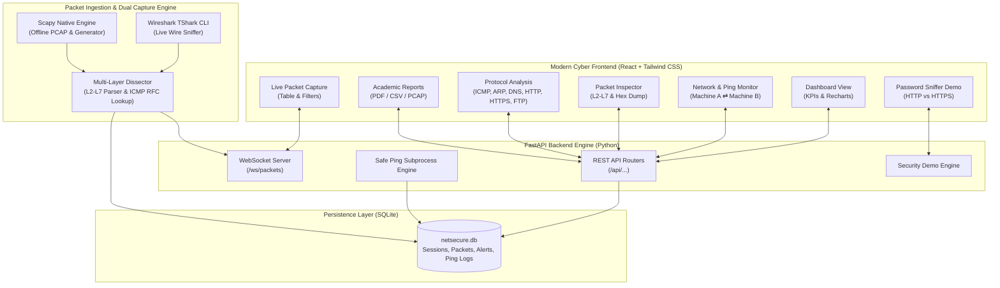

# NetSecure – Network Traffic Monitoring & Security Analysis System

> **Academic Information Security Project — Semester 5**  
> **Course:** Information Security (University Lab Project)  
> **Team Size:** 4 Members  
> **Based on:** Laboratory Exercise 12 — Wireshark LAN Traffic & Credential Sniffing Analysis

---

## 🛡️ Project Overview

**NetSecure** is a cybersecurity monitoring and packet analysis web application built to fulfill university requirements for Information Security. It enables students and security researchers to inspect real-world network traffic between two computers (Machine A and Machine B) connected over an Ethernet Local Area Network (LAN).

### Core Academic Capabilities
1. **Machine A ⇄ Machine B Interconnection**: Monitors physical and logical connectivity between two lab computers across an Ethernet LAN or crossover link.
2. **Real ICMP Ping Execution & Correlation**: Safely pings Machine B from Machine A, measuring RTT latency, packet loss %, jitter, and correlating ICMP Echo Requests (`Type 8, Code 0`) with Echo Replies (`Type 0, Code 0`).
3. **Multi-Layer Protocol Dissection**: Decodes Layer 2 Ethernet (MACs), Layer 3 Network (IPv4/IPv6, ARP, ICMP), Layer 4 Transport (TCP, UDP), and Layer 7 Application (HTTP, HTTPS/TLS, DNS, FTP).
4. **Dual-Engine Capture Architecture**: Integrates Wireshark **TShark** for live network sniffing, while seamlessly supporting **Scapy** native packet inspection and offline `.pcap` / `.pcapng` file imports.
5. **HTTP vs. HTTPS Password Sniffing Demonstration**: Includes a controlled dummy login web portal demonstrating how unencrypted HTTP transmissions expose credentials in plaintext, contrasted with encrypted TLS 1.3 Application Data.
6. **Publication-Ready Reporting**: 1-click export of academic PDF reports (using ReportLab) and CSV packet tables.

---

## 🏛️ System Architecture



---

## 📋 Technology Stack

| Layer | Technologies Used | Purpose |
| :--- | :--- | :--- |
| **Frontend** | React 18, TypeScript, Tailwind CSS v4 | Cybersecurity UI, responsive dark theme |
| **Data Viz** | Recharts, Lucide React | Protocol distribution pie charts, traffic volume timelines |
| **Backend** | Python 3.10+, FastAPI, Uvicorn | High-throughput asynchronous REST API & WebSockets |
| **Packet Engine** | Wireshark TShark, Scapy | Wire capturing, PCAP parsing, multi-layer protocol dissection |
| **Database** | SQLite3 | Persistent storage of sessions, packets, and ping logs |
| **Reporting** | ReportLab (Python), CSV | Academic PDF reports and packet spreadsheets |

---

## 🚀 Installation & Quick Start

### 1. Prerequisites
- **Python**: Version 3.10 or newer (tested with Python 3.10 – 3.14)
- **Node.js**: Version 18+ (tested with Node 22+)
- **Wireshark & TShark (Optional but Recommended for Live Wire Sniffing)**:
  - Download from [wireshark.org](https://www.wireshark.org/download.html).
  - During installation, make sure to check **Install Npcap** and **Install TShark**.
  - *Note:* If TShark is not installed, NetSecure automatically runs in **Dual Engine Mode** with offline PCAP upload and built-in lab scenario simulation.

### 2. Python Packages
Install the required Python backend libraries:
```bash
pip install fastapi uvicorn websockets scapy reportlab python-multipart requests cryptography
```

### 3. Frontend Build (Already Built in `frontend/dist`)
To rebuild or develop frontend components:
```bash
cd frontend
npm install
npm run build
cd ..
```

### 4. Running the Application
#### Windows 1-Click Launch:
Double-click `start.bat` or run in PowerShell:
```powershell
python run_server.py
```

The application will start on **`http://127.0.0.1:8000`** and automatically open in your default web browser!

---

## 🌐 Lab Setup: Connecting Machine A and Machine B

### Hardware & Network Configuration
For **Laboratory Exercise 12**, two computers in the computer lab are connected:

```
[Machine A - Examiner/Sender]                      [Machine B - Target/Receiver]
IP:  192.168.1.10                                  IP:  192.168.1.20
MAC: 00:0c:29:1a:2b:3c                            MAC: 00:0c:29:4d:5e:6f
  │                                                   │
  └─────────────── [Ethernet Switch / Cable] ─────────┘
                   Subnet: 255.255.255.0 (/24)
```

1. **Physical Connection**: Connect both computers to the same lab Ethernet switch, or connect them directly using a Cat5e/Cat6 Ethernet crossover cable.
2. **Static IP Assignment (Windows)**:
   - On **Machine A**:
     - IP: `192.168.1.10`
     - Subnet Mask: `255.255.255.0`
     - Default Gateway: `192.168.1.1`
   - On **Machine B**:
     - IP: `192.168.1.20`
     - Subnet Mask: `255.255.255.0`
     - Default Gateway: `192.168.1.1`
3. **Firewall Rule on Machine B**: Ensure ICMP Echo Requests are allowed in Windows Defender Firewall (`Windows Defender Firewall with Advanced Security` → `Inbound Rules` → Enable `File and Printer Sharing (Echo Request - ICMPv4-In)`).

---

## 🧪 Step-by-Step Lab Execution Guide

### Experiment 1: Ping Machine B from Machine A & Analyze ICMP
1. Open **NetSecure** at `http://localhost:8000`.
2. Navigate to the **Network & Ping Monitor** tab (`/network`).
3. Under **Target Host / Machine B IP**, enter Machine B's IP (`192.168.1.20` or `127.0.0.1` for local loopback test).
4. Click **Ping Machine B**.
5. Observe the live metrics:
   - Packets Sent / Received (e.g. 4/4)
   - Packet Loss (0%)
   - Round Trip Time (Min, Avg, Max RTT, Jitter)
6. Click **Inspect ICMP Packets**:
   - Machine A transmits **Echo Request (Type 8, Code 0)**.
   - Machine B replies with **Echo Reply (Type 0, Code 0)**.
   - Observe the matching identifier (`id=0x1234`) and sequence numbers (`seq=1..4`).

### Experiment 2: Multi-Protocol Traffic Analysis
Navigate to the **Protocol Analysis Suite** tab to examine:
- **ICMP**: Request/Reply correlation and RFC 792 status codes.
- **ARP**: Discovered IP-to-MAC bindings, "Who has 192.168.1.20? Tell 192.168.1.10" broadcast requests and "192.168.1.20 is at 00:0c:29:4d:5e:6f" unicast replies.
- **DNS**: Queried domain names, query types (`A`, `AAAA`), and resolved IP answers.
- **HTTP**: Cleartext request methods (`GET`, `POST`), URIs, headers, and payload bodies.
- **HTTPS**: TLS 1.3 Handshake, Server Name Indication (SNI), and encrypted Application Data records (`0x17 0x03 0x03`).
- **FTP**: Plaintext command stream (`USER`, `PASS`, `220 Ready`).

### Experiment 3: HTTP Password Sniffing Demonstration (Core Academic Feature)
1. Navigate to the **HTTP Password Sniffer** tab (`/security-demo`).
2. Toggle the protocol switch to **HTTP (Unencrypted)**.
3. Enter test credentials:
   - Username: `student_alex`
   - Password: `Secr3tLabP@ssw0rd!`
4. Click **Submit Credentials via HTTP**.
5. Watch the **5-Stage Visual Sniffing Flow**:
   - Stage 1: User enters credentials into browser form.
   - Stage 2: Browser creates unencrypted HTTP POST request.
   - Stage 3: Packet capture records frame traversing Ethernet LAN.
   - Stage 4: Packet analyzer inspects TCP Stream on Port 80.
   - Stage 5: **CRITICAL VULNERABILITY**: Cleartext credentials extracted and displayed on the sniffer view with zero decryption!
6. Now toggle the protocol switch to **HTTPS (Encrypted TLS 1.3)** and click submit.
7. Observe the contrast: The payload is encrypted with AES-256-GCM. The sniffer records only opaque ciphertext (`0x17 0x03 0x03 ...`), proving that passive eavesdropping is thwarted by TLS.

### Experiment 4: Generating Formal University Report
1. Navigate to the **Reports & Lab Guide** tab.
2. Click **Download PDF Report**.
3. ReportLab dynamically compiles a comprehensive PDF document including:
   - University Course & Team Roster (4 Members)
   - Host IPs and Physical MAC Addresses
   - Protocol Distribution Statistics
   - ICMP Ping Verification Records
   - Security Audit Findings & Plaintext Credential Exposure Evidence
   - Mitigation & Hardening Guidelines (TLS 1.3, HSTS)
4. Click **Export Packets (CSV)** for Excel analysis.

---

## 📂 Project Directory Structure

```
Information_Security/
├── backend/
│   ├── main.py                     # FastAPI server, REST routes, WebSocket broadcaster
│   ├── config.py                   # Paths, TShark discovery, Lab defaults
│   ├── database.py                 # SQLite database models, session store, packet log
│   ├── capture/
│   │   ├── capture_engine.py       # TShark live runner + Scapy native fallback
│   │   ├── interface_manager.py    # Adapter enumeration (IP, MAC, Speed, Status)
│   │   ├── pcap_handler.py         # PCAP validator, importer, and exporter
│   │   └── ping_runner.py          # Safe subprocess ping runner with input validation
│   ├── analyzer/
│   │   ├── packet_parser.py        # Multi-layer L2-L7 dissection engine
│   │   ├── icmp_analyzer.py        # RFC 792 ICMP Type/Code lookup & RTT analyzer
│   │   ├── payload_inspector.py    # Classic Wireshark Hex/ASCII dump & credential scanner
│   │   └── statistics_engine.py    # Real-time traffic KPIs, distributions, and timelines
│   ├── protocols/                  # Specialized extractors for ICMP, ARP, DNS, HTTP, HTTPS, FTP
│   ├── security_demo/
│   │   └── dummy_server.py         # Dummy login portal & HTTP vs HTTPS 5-stage sniffer engine
│   └── reports/
│       ├── pdf_generator.py        # ReportLab PDF report generation
│       └── csv_exporter.py         # CSV packet table exporter
├── frontend/                       # Modern Cyber React Application
│   ├── src/
│   │   ├── components/             # Navbar, Sidebar, Modals
│   │   ├── views/                  # Dashboard, Network, Capture, Inspector, Protocols, Demo, Reports
│   │   ├── api.ts                  # REST API & WebSocket client
│   │   ├── App.tsx                 # Root application state & navigation router
│   │   └── index.css               # Dark navy & cyber charcoal Tailwind CSS v4 styling
│   └── dist/                       # Production pre-built SPA bundle (served by FastAPI)
├── sample_data/
│   ├── sample_lan_capture.pcap     # Pre-generated authentic Lab Exercise 12 PCAP capture
│   └── generate_sample_pcap.py     # Script to generate realistic Ethernet LAN packets
├── documentation/
│   ├── README.md                   # Complete documentation
│   └── LAB_EXPERIMENT_GUIDE.md     # University submission step-by-step walk-through
├── run_server.py                   # Single-command Python launcher
└── start.bat                       # Double-clickable Windows launch batch script
```

---

## 🔧 Troubleshooting Guide

| Issue | Cause | Resolution |
| :--- | :--- | :--- |
| **"TShark not detected" badge shown in Navbar** | Wireshark is not in Windows system PATH | Install Wireshark from wireshark.org with Npcap. Add `C:\Program Files\Wireshark` to PATH. The application automatically continues in Dual Engine / Scapy mode regardless! |
| **Ping returns 100% packet loss** | Target host firewall blocking ICMP Echo Requests | On Machine B, open Windows Defender Firewall → Inbound Rules → Enable `File and Printer Sharing (Echo Request - ICMPv4-In)`. |
| **Live capture permission error on Windows** | Raw socket packet capture on Windows requires elevated privileges | Run PowerShell or CMD as **Administrator** before launching `python run_server.py`, or use the **Upload PCAP** / **Load Sample Lab PCAP** feature. |
| **Port 8000 already in use** | Another local service is using port 8000 | Run on a different port: `python -m uvicorn backend.main:app --port 8080`. |

---

## 👥 Academic Lab Team Roster (4 Members)

| Member Role | Assigned Responsibility |
| :--- | :--- |
| **Student Lead (Machine A Operator)** | Network traffic capture, TShark integration, and packet parsing |
| **Team Member 2 (Machine B Operator)** | Machine B target host administration, ping connectivity, and ARP verification |
| **Team Member 3** | HTTP unencrypted dummy application setup and password sniffing demonstration |
| **Team Member 4** | Protocol dissection (ICMP, DNS, FTP, HTTPS), report compilation, and project presentation |

---

## 📄 License
Academic Project developed for educational purposes under university course guidelines.
